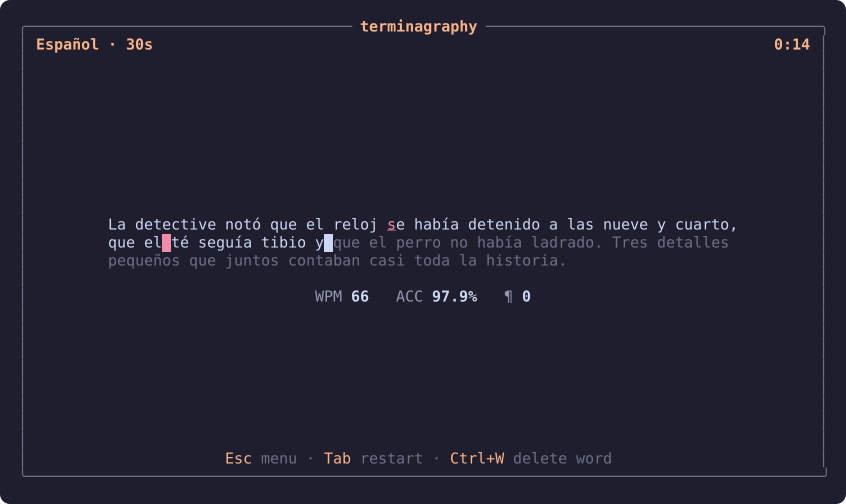
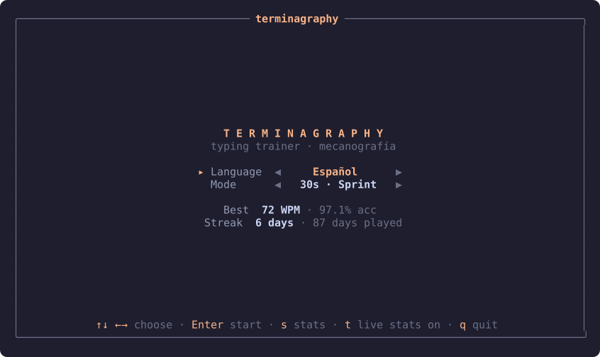
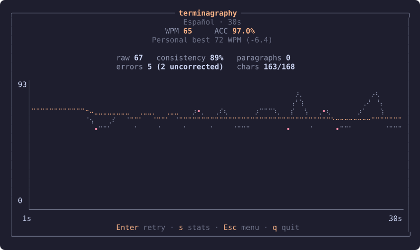
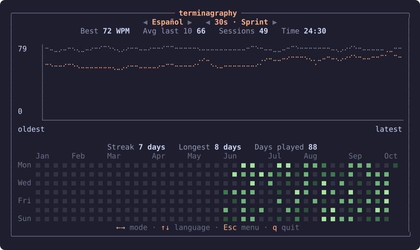

# terminagraphy

A terminal typing trainer (mecanografía) written in Rust with
[ratatui](https://ratatui.rs). Type unrelated paragraphs as fast and accurately
as you can against the clock, review your metrics, and track your progress and
daily streak over time.

> Status: first playable version. See [docs/ROADMAP.md](docs/ROADMAP.md) for what is next.



## Features

- Centered paragraph typing with live correct/incorrect highlighting.
- Timed modes: **30 seconds**, **2 minutes**, **5 minutes**.
- Endless stream of unrelated paragraphs within a session.
- **English** and **Spanish** paragraph sets (full accent support: á é í ó ú ü ñ ¿ ¡).
- End-of-session metrics: WPM, raw WPM, accuracy, consistency, errors.
- Local history with personal bests per language + mode.
- Daily tracker: streaks and a calendar heatmap of days played.

## Screenshots

| Menu | Results |
|------|---------|
|  |  |



Screenshots are rendered from the real UI with simulated input and history.
Regenerate them with `cargo test screenshots -- --ignored`.

## Install & run

Requires a recent stable Rust toolchain (edition 2024).

```sh
cargo run --release
# or install locally
cargo install --path .
terminagraphy
```

Flags:

```sh
terminagraphy --lang es --mode 2m   # jump straight into a session
terminagraphy --data-dir ./mydata   # custom storage location
```

## Controls

| Screen | Key | Action |
|--------|-----|--------|
| Menu | `↑` `↓` | Switch between language and mode |
| Menu | `←` `→` | Change the selected value |
| Menu | `Enter` | Start session |
| Menu | `s` / `t` | Stats / toggle live stats |
| Typing | type | Type the paragraph; timer starts on first key |
| Typing | `Backspace` | Delete previous character |
| Typing | `Ctrl+W` / `Ctrl+Backspace` | Delete previous word |
| Typing | `Tab` | Restart the current mode |
| Typing | `Esc` | Abort session (not saved) |
| Results | `Enter` / `s` / `Esc` | Retry / stats / menu |
| Stats | `←` `→` / `↑` `↓` | Change mode / language |
| Any | `q`, `Ctrl+C` | Quit (`q` not while typing) |

## Data

Stored locally only, nothing is sent anywhere.

| OS | History | Settings |
|----|---------|----------|
| Linux | `~/.local/share/terminagraphy/history.jsonl` | `~/.config/terminagraphy/config.toml` |
| macOS | `~/Library/Application Support/terminagraphy/history.jsonl` | `~/Library/Application Support/terminagraphy/config.toml` |
| Windows | `%APPDATA%\terminagraphy\data\history.jsonl` | `%APPDATA%\terminagraphy\config\config.toml` |

With `--data-dir <dir>` both files live in `<dir>`.

## Documentation

- [Game design](docs/GAME_DESIGN.md) — rules, modes, metrics, screens.
- [Architecture](docs/ARCHITECTURE.md) — crates, modules, data model, testing.
- [Content](docs/CONTENT.md) — paragraph file format and writing guidelines.
- [Roadmap](docs/ROADMAP.md) — milestones.
